# Sift

A personal, local-first "life app" for people who like to get things out of their head and sort them later. It runs on a phone and a laptop as an installable web app (a PWA). Your data lives on your own devices, with optional end-to-end encrypted sync through a small server you run yourself.

**Status:** in daily use by its author and still changing fast. It works, but expect rough edges. Back up your data (Settings → Backup) before trusting it with anything important.

**Try it:** https://hazymat.github.io/sift/ (everything stays in your browser until you turn sync on).

## A look round

**Tasks.** Each list has its own colour and icon (Now, Next, Later, Done, All). Sub-tasks, and two rows chosen at once, with the keys for each action shown in the bar.

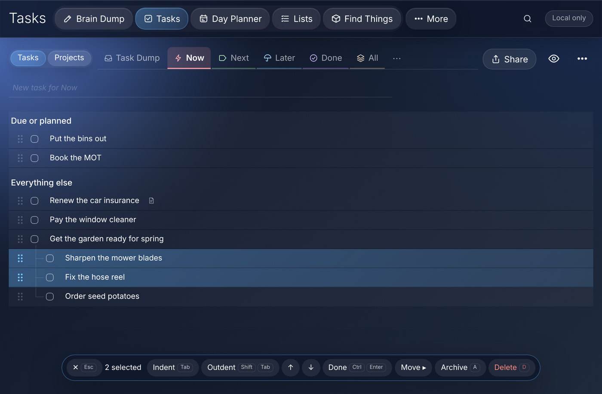

**Day Planner.** Today on paper: the schedule, the tasks for the day and a few notes.

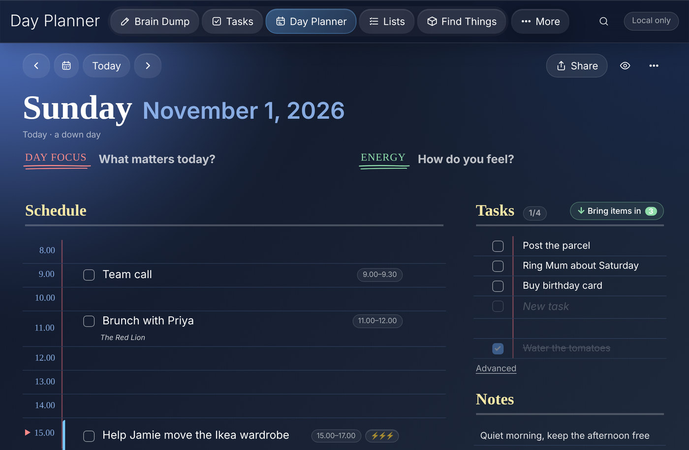

**Google Calendar.** What's on today, ready to drop onto the schedule or into the day's tasks.

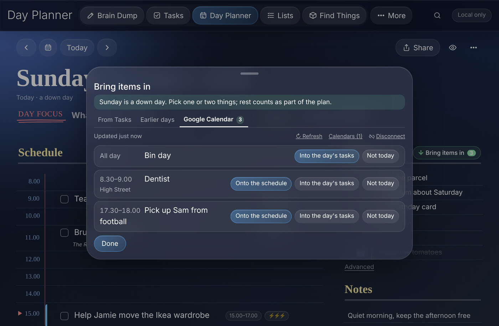

**Print a day.** The preview, calendar events included, on A5 or whatever paper you use.

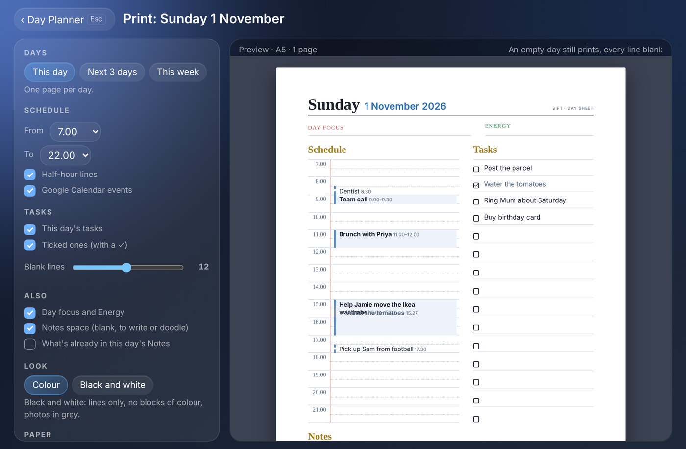

**Batch Book.** A recipe, with scaling and UK or US measures.

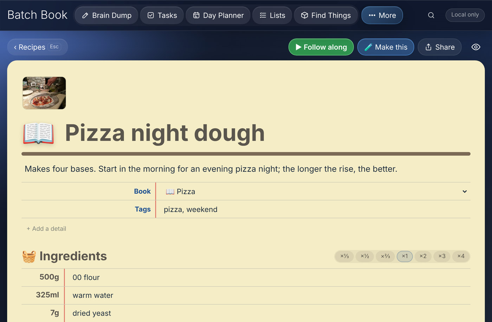

**Follow along.** One step at a time with its ingredients lit up, a one-tap timer for the wait the step mentions, and timers across the top: one has run out and is ringing in red.

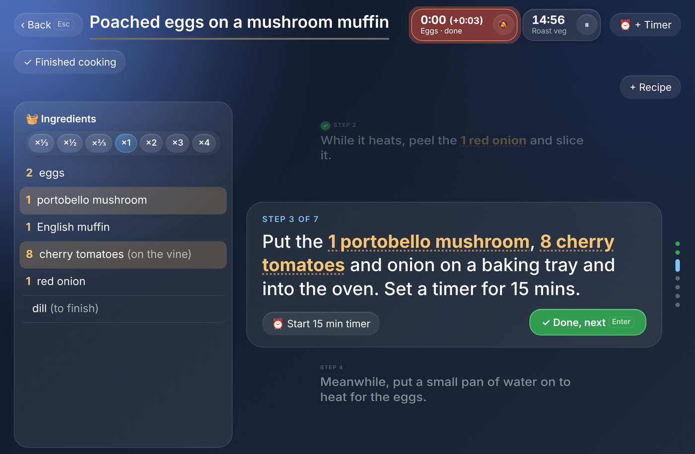

**A shared project.** Shared with two people: milestones, who's doing what, and what's waiting on someone else.

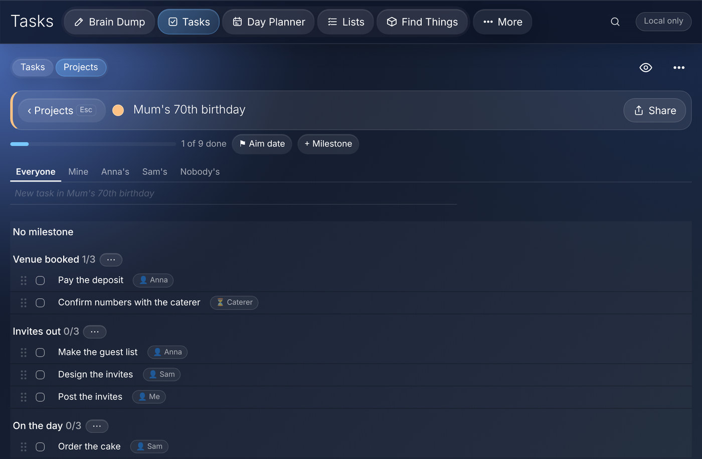

**Lists.** A shopping list, with what you have already ticked.

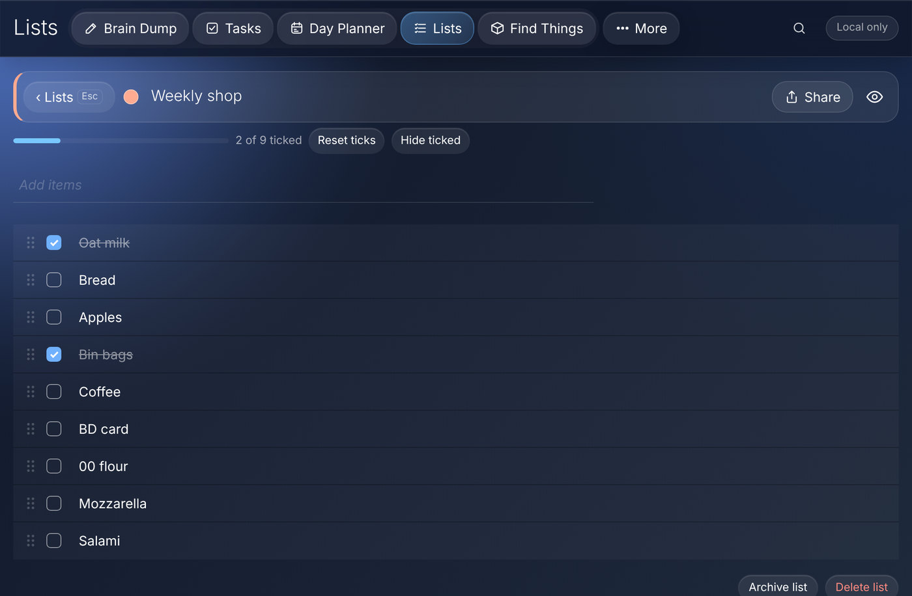

**Projects.** Everything on the go at a glance, and who each one is shared with.

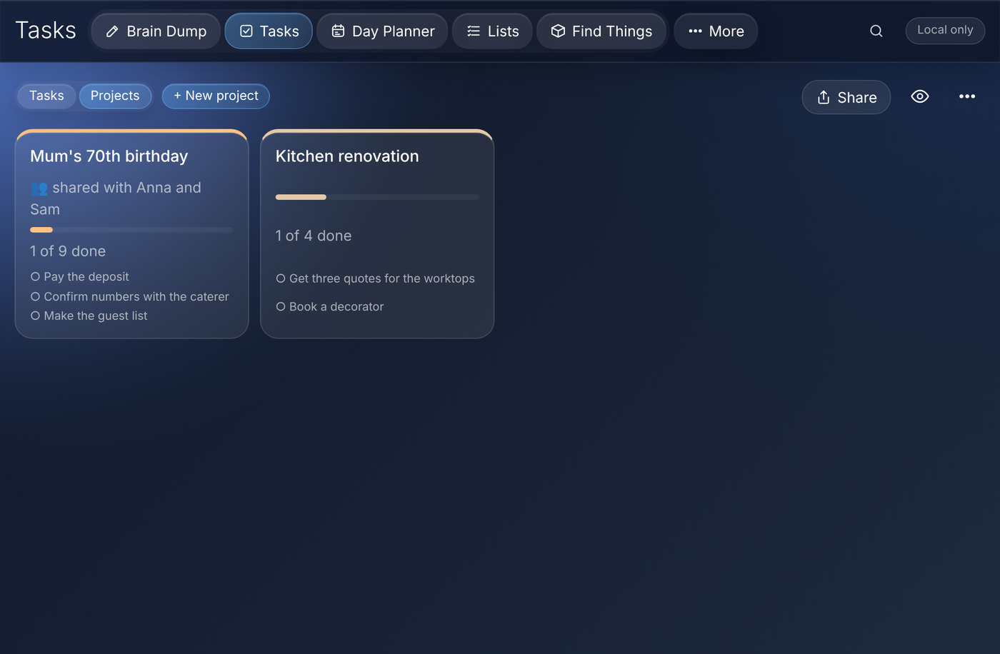

**Scans.** Receipts and letters, cut to the page and read on your own device.

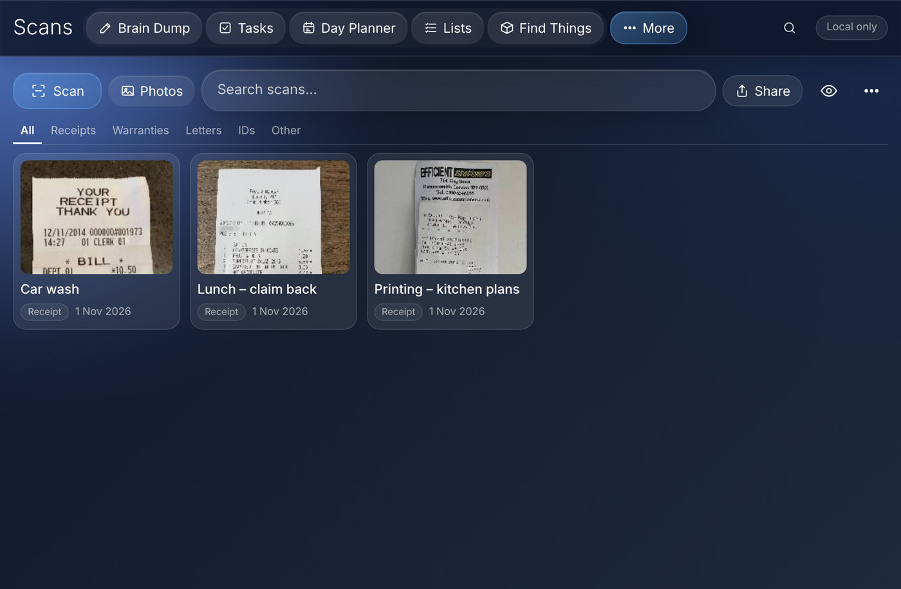

**Find Things.** A box with its label, where it lives and what is in it.

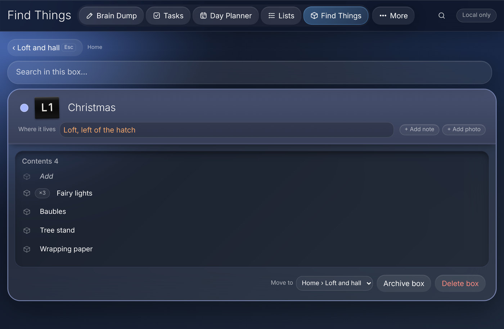

**Brain Dump.** A powerful replacement for Windows Notepad that syncs across all your devices. It saves as you type, so even a browser crash never loses what you wrote. Notes can carry photos and files.

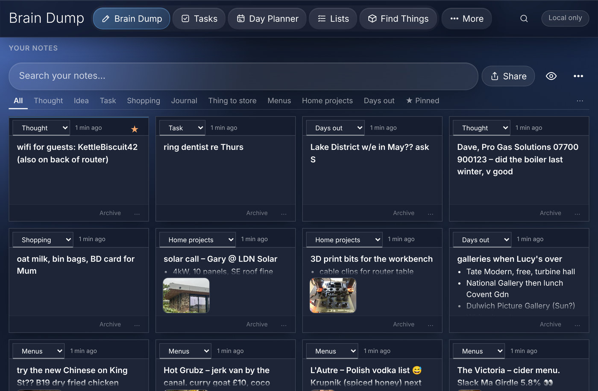

**Full screen.** Any note opens full screen (Alt+Enter) for proper writing.

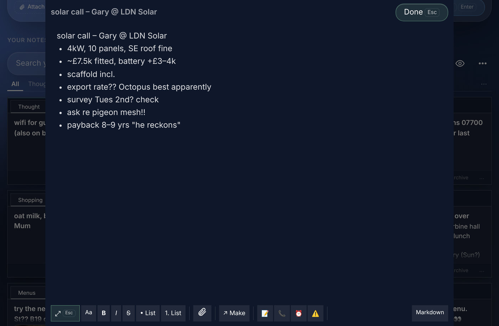

## What it does

- **Tasks:** Now, Next and Later, projects with milestones, sub-tasks, energy levels, time estimates, repeats, comments and undo for everything. More on this below.
- **Day Planner:** a lined page for today: give tasks times and lengths, carry unfinished things over, bring in what's on your Google Calendar, pick a paper style, share or print the plan.
- **Brain Dump:** capture a thought in seconds, sort it later into a task, a plan item, a Find Things item or a contact. The note stays, linked to what it became.
- **Batch Book:** recipes and the batches you make from them. More on this below.
- **Find Things:** where things live (boxes, shelves, tags) with photos and search that follows you into a box.
- **Lists:** shopping, packing, checklists and lists you reuse.
- **Contacts and Cases:** people and trades, and a timeline for each saga (a complaint, a claim, a repair) with every call, letter, photo and task in one place.
- **Scans:** photos of letters and receipts, cut to the page and read on your own device so you can search the text.
- **Notes everywhere:** the same notes editor across the app, with links between things.

### Built for the keyboard

I spend most of my day at a keyboard and hate reaching for the mouse, so everything in Sift can be done from the keys:

- Ctrl+← and Ctrl+→ move between areas, ← and → move between an area's tabs or days, ↓ goes into the list and Enter starts editing.
- Esc always steps back one level and keeps what you typed: out of a menu, out of the field, out of the panel, back to the list.
- Shift+↑ and Shift+↓ choose several rows, Shift+Alt+↑ and Shift+Alt+↓ move them (sub-tasks come along).
- Ctrl+Z and Ctrl+Y undo and redo anything, in any area, and in a note they carry on back through its earlier versions.
- Buttons show their key next to them (Enter, Esc), so you pick them up as you go rather than learning a list.

### Your phone and your laptop, in step

I plan at the laptop and do things with my phone in my hand, so Sift has to be the same on both. It installs from the browser on iPhone, Android, Windows and Mac, works offline, and syncs between your devices through a small server you run yourself. Everything is encrypted on your device first; the server only stores scrambled copies. See [server/README.md](server/README.md).

Sync carries everything, history included: undo a change on the laptop that you made on your phone this morning. Lists, notes, recipes, projects and Day Planner days can also be shared with other people on the same server.

## Tasks

I've paid for a lot of task apps over the years, and every one of them let me down in the same places. The simple ones are lovely for a week, then you need sub-tasks or a project with a deadline and there's nowhere to put them. The powerful ones bury you in buttons and settings before you've written anything down. Most of them only really work on one kind of device, or charge extra for sync, or sync badly. I wanted something quiet enough that it stays out of the way, with the power there when I reach for it, on every device I own. I couldn't find it, so I built it.

What that means in practice:

- **Quiet by default.** A new task is a line of text and Enter. Energy, estimates, dates, people and notes are there when you open a task, and nowhere else.
- **Now, Next and Later**, plus a Task Dump for anything not sorted yet. Ticked tasks move to Done, not the bin.
- **Projects** with milestones and aim dates, progress at a glance, sub-tasks as deep as you like, and drag to reorder (or Shift+Alt+arrows).
- **Repeats that don't pile up.** Tick "put the bins out" and the next one appears on the right day.
- **A record of what happened.** Any task collects dated comments, photos and files ("rang them, waiting for a reference number"), and can open as a case with its whole history on one page.
- **Joined up with the rest.** Give a task a day and it's on that day's plan. A Brain Dump note can become a task without losing the note. A task can belong to a contact or a case.
- **Shared projects.** Share a project with someone on your server, give tasks an owner, mark them as waiting on someone else, and see who has what.
- **Fast with the keyboard** and fast with a thumb: choose several rows and the bar at the bottom indents, moves, ticks, archives or deletes them all at once, each with its key shown. Swipe a row on a phone, press and hold to drag.

## Batch Book

A place for the things you make more than once: recipes, home brew, ferments, cocktails. I wanted one place for a recipe and every time I've made it, with what I changed and how it came out.

- **Recipes** with ingredients, steps, photos and whatever details suit them (glass, serves, batch volume), sorted into books of your own.
- **Scale it** (×⅓ up to ×4) and switch between UK and US measures.
- **Make a batch.** A batch starts as a copy of the recipe, so you can scale it, swap ingredients and change steps without touching the original, then keep a diary of readings, tasting notes and photos as it goes.
- **Shopping.** Mark what's in stock, and the rest goes onto a list in Lists.
- **Follow along** while you cook: full screen, one step at a time, the ingredients for that step lit up, a one-tap timer for any wait a step mentions, and several recipes side by side. What you're cooking follows you between devices.

Also: **works offline**, installs to the Home Screen, keeps a full history so you can undo anything, and can print or share most pages as text, a picture or a PDF.

Not built yet: Contracts is a first version, and cloud drives as an alternative to your own server. See the [Roadmap](https://github.com/hazymat/sift/issues/20) and [Known bugs](https://github.com/hazymat/sift/issues/21).

## Documents

- [docs/pitch.md](docs/pitch.md): why Sift, and how it compares with Apple Notes and Google Keep
- [docs/spec.md](docs/spec.md): what it is and how it works
- [docs/working-notes.md](docs/working-notes.md): how it's built and released, where it has got to (the to-do list is in GitHub Issues: Roadmap #20, Known bugs #21)
- [server/README.md](server/README.md): running your own sync server (Ubuntu or Docker)

## Layout

```
app/      the app (plain HTML/CSS/JS, no build step), published to GitHub Pages
server/   the optional sync server (Node 24, no dependencies) and its installer
docs/     spec and implementation notes
tools/    dev helpers
```

## Running it locally

Serve `app/` with caching turned off:

```
python tools/devserver.py
```

Then open http://localhost:5173. Opening `index.html` straight from disk won't work, because modules and service workers need HTTP.

## Tests

The sync server has an end-to-end check that starts its own throwaway server (needs Node 22.5 or newer):

```
cd server
node test.js
```

## Privacy

There is no account with the app itself, no analytics and no tracking. The app talks only to a sync server you choose to enter. With sync on, records and attachment files are encrypted on your device with a key the server never receives.
